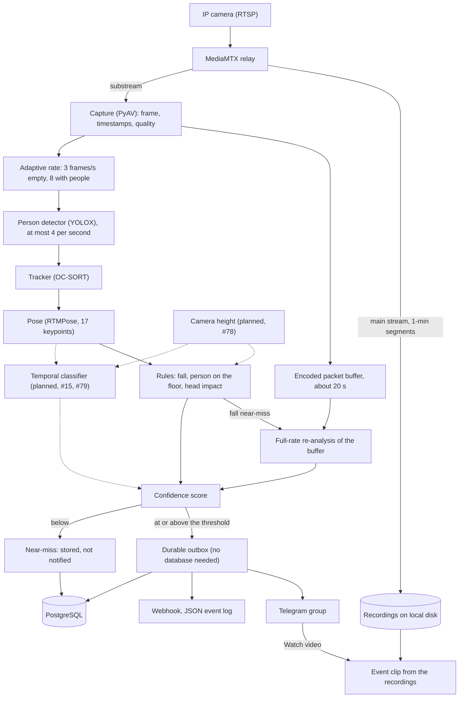

# Processing flow

From the camera to the Telegram group, as the monitoring service (`fim run`) runs it. Dashed parts are planned: the camera height in the rules (#78) and the temporal classifier combined with the rules (#15, #79). Design and reasons: [`ARCHITECTURE.md`](ARCHITECTURE.md).

## Stages

1. **Relay and recording.** MediaMTX holds the only RTSP connection of each stream (consumer cameras accept few), records the main stream in 1-minute segments and relays the substream to the app. Recording never depends on analysis.
2. **Capture.** PyAV decodes the substream. Every frame keeps its camera timestamp, its arrival time and its UTC time apart, with a timestamp quality flag. The encoded packets of the last ~20 s stay in memory.
3. **Adaptive rate.** 3 analysed frames per second while nobody is in view (`FIM_ANALYSIS_EMPTY_SCENE_FPS`), 8 with people (`FIM_ANALYSIS_PERSON_VISIBLE_FPS`), always the latest frame.
4. **Perception.** The person detector runs at most 4 times per second (`FIM_PERSON_DETECTOR_MAX_FPS`); in between, the pose estimator follows the people it found. OC-SORT keeps the track ids; RTMPose gives 17 keypoints per person.
5. **Rules.** Fall state machine (upright, suspected, fallen, recovering), person lying outside safe zones, possible head impact with at least two evidences. Every event has a confidence score.
6. **Full-rate re-analysis.** A fall near-miss outside safe zones has its buffered packets analysed again at up to 12 frames per second, in its own thread; a fall seen there is alerted.
7. **Alert decision.** An event at or above `FIM_ALERT_MIN_CONFIDENCE` (50 %) is an alert; below, a near-miss stored and never notified.
8. **Outputs.** Alerts go through a durable outbox on disk, so they are delivered even when the database is down: Telegram (one queue per chat), webhook, JSON event log, and PostgreSQL as one more output.
9. **Video.** "Watch video" asks MediaMTX for the recording from 20 s before to 60 s after the event and sends the clip to the group.

A health watchdog follows every stage and reports degraded monitoring (camera lost, analysis below the minimum rate, disk full, delivery failing) through the same outbox.
